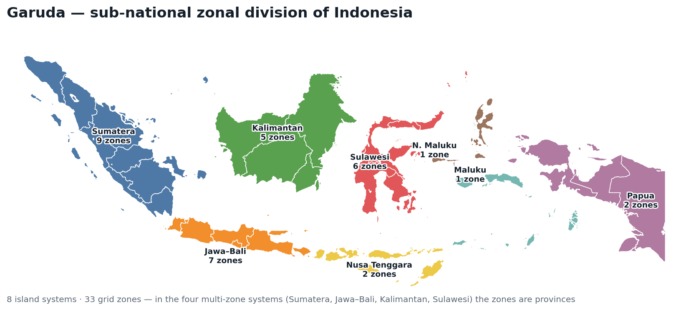

# Garuda: Grid And Renewable Utilization & Deployment Analysis

[](https://github.com/Power-Lab/garuda/actions/workflows/ci.yml)

Garuda is an open-source zonal capacity-expansion and dispatch model of the
Indonesian power system. It represents 8 island systems divided into 33 grid
zones and, where data permit, individual village and industrial sites within a
zone. The optimisation core is written in Julia with
[JuMP](https://jump.dev/); data validation, screening and post-processing are in
Python. The optimisation engines use the open-source HiGHS solver by default;
Gurobi is optional.



*The 33 grid zones of the 8 island systems; each zone corresponds to a
province. Site-level case study: Timor / NTT
([`docs/case_study_timor.md`](docs/case_study_timor.md)). Province boundaries:
[superpikar/indonesia-geojson](https://github.com/superpikar/indonesia-geojson).
Regenerate with `python tools/plot_zones_map.py` (requires geopandas).*

## Model

| Engine | Output | Problem class | Entry point |
|--------|--------|---------------|-------------|
| Screening | Emissions, RE share and reliability gaps of the existing fleet | Arithmetic | `python tools/screening.py data_indonesia/2030/maluku` |
| RE resource | Developable solar/wind capacity, capacity factor, annual potential | Arithmetic | `python tools/re_resource.py data_indonesia/2030/sulawesi` |
| Dispatch | Operation of a fixed fleet: generation, non-served energy, LOLE, peak shortage | LP | `run_model.jl` with `"engine": "dispatch"` |
| Capacity expansion | Least-cost investment and dispatch under policy constraints | MILP | `run_model.jl` (default) |

Screening and RE resource need only Python (`pandas`, `numpy`). Dispatch and
expansion share one model definition (`build_model!`); dispatch fixes capacity
and, by default, relaxes unit commitment. The formulation is in
[`MODEL.md`](MODEL.md); the resource engine in
[`docs/re_resource.md`](docs/re_resource.md).

## Installation

Requires [Julia](https://julialang.org/downloads/) (tested with 1.12; package
versions pinned in `Manifest.toml`) and Python ≥ 3.9. Platform notes:
[`docs/environment_setup.md`](docs/environment_setup.md).

```bash
pip install pandas numpy click pyyaml
julia --project=. bootstrap.jl   # instantiate the environment, check HiGHS
```

## Usage

```bash
# Solver-free screen of an island
python tools/screening.py data_indonesia/2030/maluku

# Validate inputs, scaffold a config and run (dispatch LP on HiGHS)
python tools/launcher.py --island timor_demo --year 2030 --scenario gridvillage \
  --clean reference --engine dispatch --run

# HTML + PDF report from a results folder
python tools/report.py results/gridvillage_timor_demo_2030_reference

# Batch: one job per island × year × scenario × clean case
python generate_jobs_local.py --scenarios-file scenario_timor_demo.yml \
  --run-script run_model.jl --output-root jobs

# Input validation only
python tools/validate_schema.py data_indonesia/2030/<island>
julia --project=. run_model.jl --config <cfg.json> --preflight-only
```

Batch jobs write `jobs/<job_name>/config.json` and `results/<job_name>/`.
`generate_jobs.py` is the SLURM equivalent; it requires a batch-script template
(`--submit-script`, none is shipped), and `--submit` calls `sbatch`.

## Solvers

The `"solver"` key selects `"highs"` (default, open-source) or `"gurobi"`
(licence required; imported only when selected). The dispatch LP solves in
seconds to minutes on HiGHS. The exact expansion MILP is slow on HiGHS
(≈ 15–30 min for `timor_demo`). `"relax_uc": true` LP-relaxes the commitment
and site-connection binaries and solves in seconds, at ≈ 0.8 % below the exact
cost on `timor_demo` (`village` scenario; a lower bound). Use the exact MILP for
reported results: `"relax_uc": false` is the `run_model.jl` default for
expansion, while `tools/launcher.py` requires `--exact-uc`.

## Configuration

A scenario YAML lists `islands`, `years`, `scenarios`, `cleans` (`reference`,
or `clean` with a CO₂ cap and RE floor), `island_params` (BAU CO₂ by island) and
`co2_limits` (by year and island). Scenarios: `base`, `grid`, `village`,
`gridvillage`, `nocoal`, `highimportprice`; `captive` and `gridcaptive` are
aliases of `village` and `gridvillage` (industrial sites use the village
formulation). Per-run keys, set at the YAML top level or in a job's
`config.json`:

| Key | Default | Meaning |
|-----|---------|---------|
| `solver` | `"highs"` | `"highs"` or `"gurobi"` |
| `engine` | `"expansion"` | `"expansion"` or `"dispatch"` |
| `relax_uc` | engine-dependent | LP-relax the unit-commitment and site-connection binaries; on for dispatch, off for expansion |
| `mipgap` | `0.01` | relative MIP gap |
| `lp_method` | `-1` | Gurobi `Method` for LPs and the MIP root relaxation (`-1` automatic, `0` primal, `1` dual, `2` barrier, `3`–`5` concurrent); ignored by HiGHS |
| `RE_limit` | `0.34` | minimum renewable share (`clean` runs) |
| `import_price` | `59.0` $/MWh | price sites pay for grid imports (× 1.21 under `highimportprice`) |
| `export_price` | `0.0` $/MWh | price sites receive for exports; `0` = unremunerated spill; keep ≤ `import_price` |
| `policy_scope` | `"grid"` | `clean` constraints apply to grid generation (`"grid"`) or include sites (`"system"`) |
| `export_backed_by_generation` | `false` | each site's hourly export must not exceed its own renewable generation that hour; when `false`, `export_price > import_price` is rejected on datasets with no grid demand |
| `village_storage_max_mwh` | `208.0` MWh | per-unit cap on new site storage energy |
| `battery_duration_h` | `0.0` h | fixed energy-to-power ratio for new site storage; `0` = co-optimised |
| `run_tag` | `""` | results-folder suffix (`results/<scenario>_<island>_<year>_<clean>__<tag>/`), for runs that differ only in config keys |

The job generators copy these keys via `PASSTHROUGH_KEYS` in `generate_jobs.py`
and `generate_jobs_local.py`; a new key not added there is dropped from
`config.json` and the run silently uses the default.

## Outputs

Each run writes CSVs to `results/<job_name>/`: `generator_results.csv`,
`storage_results.csv`, `transmission_results.csv`,
`transmission_flow_results.csv`, `cost_results.csv`,
`clean_energy_results.csv` (CO₂, RE share), `nse_results.csv` and
`site_*_results.csv`. Dispatch runs add `reliability_results.csv` and
`site_reliability_results.csv` (non-served energy, LOLE, peak shortage by zone
and site). Column definitions: [`docs/outputs_guide.md`](docs/outputs_guide.md).

## Analysis and interoperability tools

| Tool | Purpose | Example |
|------|---------|---------|
| `tools/export_pypsa.py` | Export the zonal network to [PyPSA](https://pypsa.org) | `python tools/export_pypsa.py data_indonesia/2030/sulawesi --netcdf out.nc` |
| `tools/validate_pypsa_parity.py` | Check the export against the dispatch engine (system non-served energy matches on `maluku` and a six-zone grid-only `sulawesi` case) | `python tools/validate_pypsa_parity.py <folder> --reference <results_dir>` |
| `tools/launcher.py` | Validate inputs, estimate problem size and runtime, write and optionally run a config | `python tools/launcher.py --island maluku --year 2030 --scenario base --clean reference` |
| `tools/report.py` | Render an HTML and PDF report of a run; `--lang id` for Bahasa Indonesia | `python tools/report.py results/base_maluku_2030_reference` |
| `tools/coordination_value.py` | Compute the cost, diesel, emissions and non-served-energy difference between standalone and grid-coordinated site plans | `python tools/coordination_value.py run --island timor_demo --year 2030` |
| `tools/sensitivity.py` | Sweep parameters around a base case: fuel price, demand, solar capacity factor, connection cost, interconnection cap, import/export prices and site-storage duration | `python tools/sensitivity.py run --island timor_demo --year 2030 --scenario gridvillage --param fuel=0.8,1.2` |
| `tools/ntt/build_grid_demand.py` | Build the Timor grid-bus load (NTT zone-2 series net of village load) and fleet for village-to-grid export | `python -m tools.ntt.build_grid_demand --share 0.42 --out-dataset timor__market --fleet rescale` |

`tools/report.py` additionally needs `matplotlib` and `jinja2`; the PyPSA tools
need `pypsa`. Details: [`docs/pypsa_export.md`](docs/pypsa_export.md),
[`docs/experience_layer.md`](docs/experience_layer.md),
[`docs/coordination_value.md`](docs/coordination_value.md),
[`docs/sensitivity.md`](docs/sensitivity.md).

## Repository structure

| Path | Contents |
|------|----------|
| `data_indonesia/<year>/<island>/` | Zonal inputs: `generators.csv`, `demand.csv`, `generators_variability.csv`, `fuels_data.csv`, optional `network.csv`, site files (`site_*`, `village_*`, `ip_*`). Schema: [`data_indonesia/README.md`](data_indonesia/README.md) |
| `functions/` | Julia core: data loading (`input_data.jl`, `zonal_system.jl`, `site_aliases.jl`, `zones.jl`), `solver.jl`, `optimizer.jl` (`build_model!`, expansion), `dispatch_engine.jl`, `result_extraction_function.jl`, `function_compiler.jl`, `preflight.jl` |
| `tools/` | Python engines (`screening.py`, `re_resource.py`), `validate_schema.py`, PyPSA interop, `launcher.py`, `report.py`, GIS siting pipeline (`dem_slope.py`, `candidate_land.py`, `resource_siting.py`, `ntt/`) |
| `run_model.jl` | Entry point: reads a `config.json`, runs the selected engine, writes results |
| `scenario_*.yml` | Scenario definitions |
| `tests/` | `verify_data_core.jl` (no-solver regression), `verify_capacity_accounting.jl` (no-solver check that every generator is capacity-constrained), `check_dispatch_headlines.jl` (CI dispatch reference) and the `pytest` suite |

## Documentation

Audience guides: [data users](docs/guide_data_consumer.md),
[analysts](docs/guide_analyst.md), [policy stakeholders](docs/guide_policy.md)
([Bahasa Indonesia](docs/guide_policy_id.md)).

| Document | Covers |
|----------|--------|
| [`MODEL.md`](MODEL.md) | Mathematical formulation, cross-referenced to the code |
| [`data_indonesia/README.md`](data_indonesia/README.md) | Input data dictionary |
| [`data_indonesia/DATA_PROVENANCE.md`](data_indonesia/DATA_PROVENANCE.md) | Data sources and the official-source replacement map |
| [`docs/village_adaptation.md`](docs/village_adaptation.md) | Site modelling and scenario semantics |
| [`docs/case_study_timor.md`](docs/case_study_timor.md) | Timor / NTT case study |
| [`docs/new_region_guide.md`](docs/new_region_guide.md) | Adding a region |
| [`docs/re_resource.md`](docs/re_resource.md) | RE resource engine and GIS siting |
| [`docs/outputs_guide.md`](docs/outputs_guide.md) | Result files and headline metrics |
| [`docs/environment_setup.md`](docs/environment_setup.md) | Julia, Python and Gurobi setup |
| [`docs/README.md`](docs/README.md) | Full documentation index |

## Troubleshooting

| Symptom | Fix |
|---------|-----|
| `Input schema validation failed: …` | Fix the reported inputs, or set `GARUDA_SKIP_VALIDATION=1` |
| `Solver "gurobi" could not start …` | No valid Gurobi licence: use `"highs"` or set `GRB_LICENSE_FILE` |
| `Missing required input files … network.csv` | `grid`, `gridvillage`, `highimportprice` and `nocoal` require `network.csv`; otherwise use `base` or `village` |
| Julia package error on first run | Re-run `julia --project=. bootstrap.jl` |

## Citation, provenance and licence

Cite Garuda using [`CITATION.cff`](CITATION.cff). Garuda extends the
capacity-expansion model of `village-indonesia-100gw`, the IESR / UC San Diego
Power Transformation Lab study behind Indonesia's 100 GW village-solar
programme.
Released under the MIT Licence ([`LICENSE`](LICENSE)); see
[`CONTRIBUTING.md`](CONTRIBUTING.md) for contributions.
